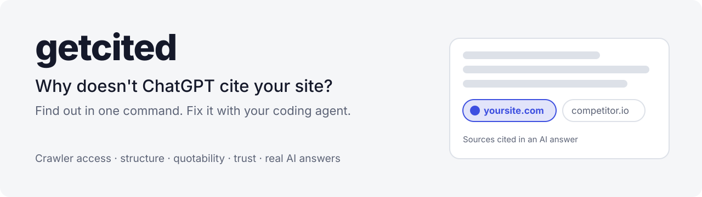
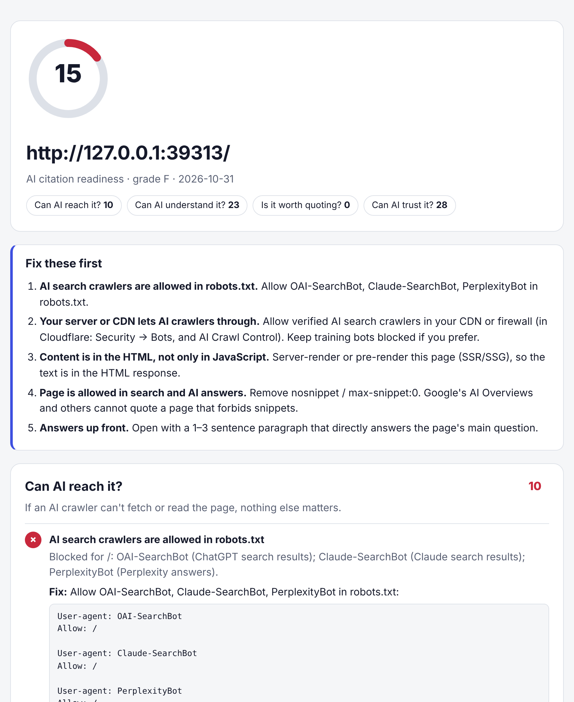

<div align="center">

<picture>
  <source media="(prefers-color-scheme: dark)" srcset="docs/banner-dark.svg">
  
</picture>

<br>

[](https://github.com/mohamedsaidyekhlef-png/getcited/actions/workflows/ci.yml)
[](LICENSE)


**[Quick start](#quick-start) · [Agent skill](#use-it-as-an-agent-skill) · [What it checks](#what-it-checks) · [The fixes](#the-fixes) · [FAQ](#faq)**

</div>

---

People now ask ChatGPT, Perplexity, Claude, Gemini and Google AI Overviews instead of searching. Those engines answer with a handful of cited sources. If your site isn't one of them, you're invisible, and nothing in your analytics tells you why.

Usually it's one of a few fixable things:

- **A crawler is blocked.** robots.txt, or a CDN setting such as Cloudflare's AI-bot blocking, turns away the bots that fetch pages for AI answers.
- **The page is empty to a bot.** Most AI crawlers don't run JavaScript, so a client-rendered page looks blank to them.
- **There's nothing worth quoting.** The answer is buried in paragraph four, or the page has no numbers, sources or author an engine can trust.

**getcited finds which, in one command, and drafts the fixes.** Run it as a coding-agent skill and it applies them in your codebase, then checks real AI answers to see whether you're being cited.

```bash
npx github:mohamedsaidyekhlef-png/getcited https://yoursite.com
```

<div align="center">

<br><sub>A site that does everything wrong. The CDN check is the one most people miss: robots.txt says "allowed", but the firewall turns the bots away.</sub>
</div>

## Quick start

You need Node 18+. Nothing is installed globally and there are no dependencies.

```bash
npx github:mohamedsaidyekhlef-png/getcited https://yoursite.com              # one page
npx github:mohamedsaidyekhlef-png/getcited https://yoursite.com --pages 10   # plus 10 linked pages
npx github:mohamedsaidyekhlef-png/getcited https://yoursite.com --html report.html --fix ./geo-fixes
```

| Option | |
|---|---|
| `--pages <n>` | Also audit up to *n* linked pages on the same site (max 50) |
| `--html <file>` | Visual report, light and dark, works offline |
| `--md <file>` / `--json [file]` | Markdown or JSON (JSON to stdout with no file) |
| `--fix <dir>` | Draft fixes: `llms.txt`, JSON-LD, robots.txt additions and an ordered `FIXES.md` |
| `--file <page.html> --url <url>` | Audit a local build before you deploy |
| `--min <score>` | Exit with code 2 below this score: a CI gate |
| `--no-bots` | Skip the CDN check that fetches with real AI-crawler user agents |

## Use it as an agent skill

This is where getcited earns its keep. Install it into Claude Code, Codex, Cursor, OpenCode or Gemini CLI:

```bash
npx skills add mohamedsaidyekhlef-png/getcited
```

Then ask your agent:

> *Why doesn't ChatGPT cite our site? Audit https://oursite.com and fix what you can.*

The skill tells the agent to:

1. **Audit** the site and explain the three fixes that matter most, with evidence.
2. **Fix** them in your codebase:
   - merge the robots.txt rules
   - switch client-rendered pages to server rendering
   - add JSON-LD filled with facts from your code
   - rewrite the opening paragraph to answer first
3. **Re-audit** to show the score change.
4. **Check real answers.** It asks the engines your customers' questions with the agent's own web search and records whether you're cited and who is cited instead. It saves this to `.geo/prompts.json`, so each run shows progress.

It's built not to invent anything. It never makes up a statistic, author, date, logo or profile link. Anything it can't confirm is left as a `TODO` for you, because a fabricated number is worse than none.

## What it checks

25 checks in four questions. Each one comes with the evidence it found, the fix, and why it matters.

<details open>
<summary><b>Can AI reach it?</b> If not, nothing else matters.</summary>

| Check | What it catches |
|---|---|
| AI search crawlers in robots.txt | OAI-SearchBot, ChatGPT-User, Claude-SearchBot, Claude-User, PerplexityBot, Perplexity-User, Googlebot and Bingbot, evaluated per RFC 9309: most specific group, longest rule, Allow wins ties |
| **CDN / firewall blocking** | Fetches the page as OAI-SearchBot, GPTBot, ClaudeBot and PerplexityBot with their real user agents and compares with a browser. Catches 403s and challenge pages that robots.txt can't show |
| Content in the HTML | Flags pages whose text only appears after JavaScript runs |
| Indexable and quotable | `noindex`, `nosnippet` and `max-snippet:0` in meta tags or `X-Robots-Tag` headers |
| Response time · sitemap | Slow HTML gets dropped by live fetchers |
| Training crawlers | GPTBot, ClaudeBot, Google-Extended, CCBot and others. **Reported, not scored:** blocking training is a business choice and doesn't remove you from AI search |

</details>

<details>
<summary><b>Can AI understand it?</b></summary>

Title, meta description, one H1 with a clear outline, valid JSON-LD with specific types, an Organization or Person entity with `sameAs` links, `lang`, canonical URL, and `llms.txt` (a small bonus, since the big engines don't rely on it yet).

</details>

<details>
<summary><b>Is it worth quoting?</b></summary>

The signals the [GEO study (KDD 2024)](https://arxiv.org/abs/2311.09735) found move visibility in AI answers:
- statistics density
- links to authoritative sources
- attributed quotations

Plus:
- an answer in the first paragraph
- lists, tables and question headings that are easy to lift
- enough depth to answer from

</details>

<details>
<summary><b>Can AI trust it?</b></summary>

A named author or publisher, a recent `dateModified`, HTTPS, and linked About and Contact pages.

</details>

## The fixes

`--fix ./geo-fixes` writes files you can review and ship:

| File | |
|---|---|
| `FIXES.md` | Every failing check, most damaging first, with the exact fix |
| `robots-ai-additions.txt` | Allow rules for exactly the AI search crawlers you're blocking |
| `schema.jsonld.html` | Organization and Article or WebPage JSON-LD (plus FAQPage when the page has question headings), filled from your page. Unknowns are `TODO`, never guessed |
| `llms.txt` | A map of your key pages for AI tools |

## In CI

```yaml
- run: npx github:mohamedsaidyekhlef-png/getcited https://staging.yoursite.com --min 70 --md geo.md
```

The step fails when a deploy would make you less citable, for example a new robots rule or a page that moved to client rendering.

## FAQ

<details><summary><b>Does a high score guarantee citations?</b></summary><br>No. It makes you <i>citable</i>: reachable, understandable, quotable and trustworthy. Whether you're cited also depends on competition and authority. That's why the skill checks real answers and records them over time.</details>

<details><summary><b>Should I block GPTBot or ClaudeBot?</b></summary><br>That's your call. Training crawlers and search crawlers are separate. getcited reports training blocks but never scores them, and it tells you if a search crawler, the kind that drives citations, is blocked.</details>

<details><summary><b>Is llms.txt worth it?</b></summary><br>It's cheap and harmless, so getcited drafts one. But adoption by the major engines is still limited, so it carries about 1.5% of the score. Fix access and content first.</details>

<details><summary><b>Does it send my data anywhere?</b></summary><br>No. The CLI fetches your public pages the way a crawler would, and there's no getcited server or telemetry.</details>

## Contributing

Each check is one function in [`src/checks.mjs`](src/checks.mjs) with a weight, evidence and a fix. New AI crawlers go in [`src/robots.mjs`](src/robots.mjs). `npm test` runs the suite against a local good site and a deliberately broken one.

## License

[MIT](LICENSE) © 2026 Mohamed Said Yekhlef
