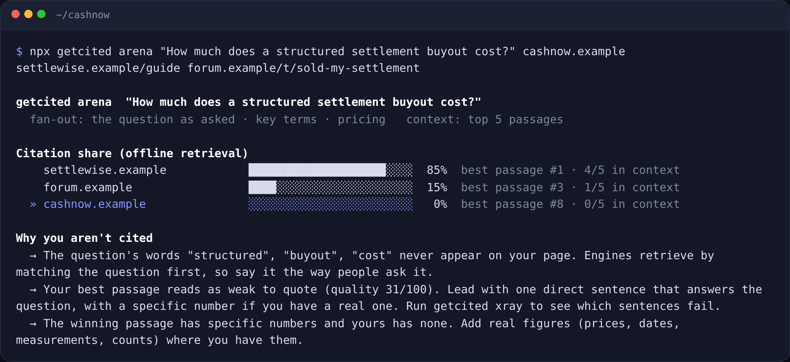
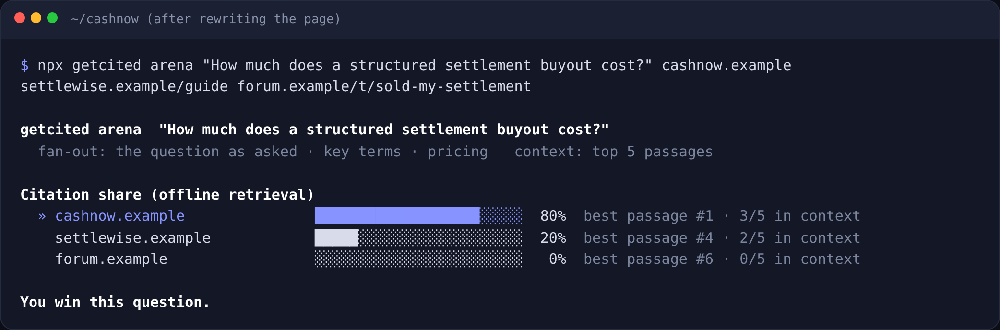
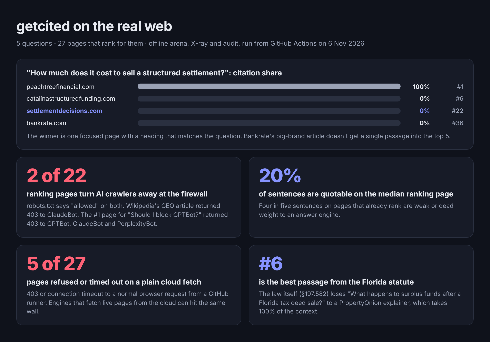
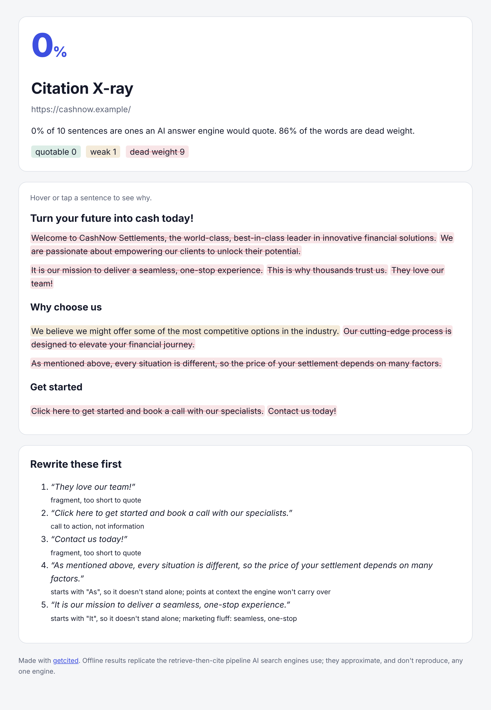

<div align="center">

<picture>
  <source media="(prefers-color-scheme: dark)" srcset="docs/banner-dark.svg">
  
</picture>

<br>

[](https://github.com/mohamedsaidyekhlef-png/getcited/actions/workflows/ci.yml)
[](LICENSE)


**[Arena](#-arena-who-gets-cited-and-why) · [X-ray](#-x-ray-what-an-ai-would-quote) · [Tests in CI](#-citation-tests-in-ci) · [Regressions](#-regression-monitoring) · [Truth](#-truth-what-ai-gets-wrong-about-you) · [Audit](#-audit-can-ai-even-reach-you) · [Bench](#-prove-it-bench-against-a-real-engine) · [Agent skill & MCP](#-agent-skill-and-mcp-server)**

<sub>AI search testing infrastructure: open-source CLI, GitHub Action and MCP server · <a href="https://www.scairos.com/getcited">scairos.com/getcited</a></sub>

</div>

---

You test your code. You test your page speed. Nobody tests whether ChatGPT, Perplexity, Claude or Google AI Overviews will **cite** them, and that's where your customers now ask their questions.

AI visibility tools cost $99–$500 a month, and they're dashboards: they tell you that you lost, weeks later. **getcited tells you *why* you lose, before you ship, for free.**

```bash
npx github:mohamedsaidyekhlef-png/getcited arena "How much does a structured settlement buyout cost?" \
  cashnow.example  settlewise.example/guide  forum.example/t/sold-my-settlement
```



Rewrite one page with that advice, run it again:



**0% → 80% citation share, from one rewrite.** That's the loop getcited gives you, for every question your customers ask.

## On the real web

We ran getcited on **5 real questions and the 27 pages that rank for them**, including our own sites. [Read the study →](study/README.md)



- **Passages win, brands don't.** One focused page took 100% of the context for a money question. Bankrate's best passage came in at #36.
- **The firewall beats robots.txt.** The #1 page for *"Should I block GPTBot?"* returns 403 to GPTBot, ClaudeBot and PerplexityBot. Wikipedia's GEO article refused ClaudeBot.
- **Ranking pages are mostly unquotable.** On the median page, only 20% of sentences are quotable.

Every raw result is in [`study/results/`](study/results/), and the [workflow](.github/workflows/study.yml) re-runs the study on push.

## Watch: the six pillars

**01 · Citation Arena**: who AI cites instead of you, and why


**02 · Citation X-ray**: which sentences an AI would quote


**03 · Tests in CI**: the PR fails when a change costs you a citation


**04 · Regression monitoring**: what changed since the last run, and why


**05 · Truth**: what AI gets wrong about your brand


**06 · Audit**: robots.txt says allowed, the firewall says 403


[Full 88-second film (MP4)](docs/video/getcited-explained.mp4) · [scairos.com/getcited](https://www.scairos.com/getcited)

The videos are code too: [`docs/video/film.html`](docs/video/film.html) draws every frame, and [`render.mjs`](docs/video/render.mjs) renders them to MP4.

## How it works

AI answer engines don't rank pages. They run **retrieve-then-cite**:

1. They **fan your question out** into sub-queries.
2. They pull **passages** (a few paragraphs under one heading) from many pages.
3. They rank the passages and put the top few into the model's context.
4. The model writes the answer and **cites the passages it used**.

If your best passage doesn't make that shortlist, you're invisible, however good the rest of your page is.

getcited **replicates that pipeline on your machine**:
- chunking that keeps each heading as context
- deterministic query fan-out
- BM25 ranking, adjusted for how quotable each passage is
- reciprocal rank fusion across the sub-queries

It runs on your page and your competitors' pages. You get the citation share each source would get, the exact passages the engine would read, and a plain-English diff of what the winner has that you don't.

No API key. Same input, same result, every run, so you can put it in CI.

To see what a real model does with those passages, add `--model`. It answers from the top passages and cites them. The passages are **shuffled on every sample to cancel the position bias** that skews single-shot tests.

## 🥊 Arena: who gets cited, and why

```bash
getcited arena "<question>" <your-page> <competitor-page> [more competitors...]
getcited arena "best CRM for a 5-person agency" you.com/crm --vs hubspot.com/... --vs g2.com/...
getcited arena "..." ./dist/pricing.html --url https://you.com/pricing --vs rival.com/pricing   # before you deploy
```

| You get | |
|---|---|
| **Citation share** | The rank-weighted share of the engine's context each source holds |
| **The context** | The exact passages an engine would read, in order |
| **Why you lose** | Question words missing from your page, the answer split across sections, no numbers where the winner has them, passages too long to quote |
| **Live answers** | Add `--model`. A real model answers and cites; share is averaged over shuffled samples |

`--html arena.html` writes a visual report.

## 🩻 X-ray: what an AI would quote

```bash
getcited xray https://yoursite.com/pricing --html xray.html
```

Engines lift sentences that **stand on their own and state one specific fact**. X-ray scores every sentence on your page and marks it **quotable**, **weak** or **dead weight**, with the reason. For example:
- it starts with "It", so it means nothing out of context
- it's marketing fluff: "world-class", "seamless", "unlock"
- it's a call to action, not information
- it's 60 words, too long to lift



## ✅ Citation tests in CI

Put the questions your customers ask in `getcited.yml`:

```yaml
site: https://yoursite.com/pricing
competitors:
  - https://rival.com/pricing
  - ./snapshots/g2-category.html     # saved HTML works too: fully reproducible tests
min_score: 70                        # static audit gate
questions:
  - ask: How much does YourProduct cost?
    expect: [cited, top3]
  - ask: Best invoicing tool for freelancers in Morocco?
    expect: share>=30%
  - ask: Does YourProduct integrate with Stripe?
    expect: live cited               # checked with a real model when --model is set
```

```bash
getcited init https://yoursite.com --vs https://rival.com   # writes a starter file from your own page
getcited test                                                # ✓/✗ per question, exit 1 on failure
```

### GitHub Action

```yaml
# .github/workflows/ai-citations.yml
on: [pull_request]
jobs:
  getcited:
    runs-on: ubuntu-latest
    steps:
      - uses: actions/checkout@v4
      - uses: mohamedsaidyekhlef-png/getcited@v1
        with:
          spec: getcited.yml
          badge: .github/badges/getcited.json      # optional
          # model: openai:gpt-4.1-mini              # optional live checks
        # env:
        #   OPENAI_API_KEY: ${{ secrets.OPENAI_API_KEY }}
```

The job summary shows each question with ✓/✗ and how to fix it. The PR fails when a change, such as a rewrite, a redesign or a new robots rule, would cost you a citation.

A **README badge** is a [shields.io endpoint](https://shields.io/badges/endpoint-badge) away. Commit the `--badge` JSON and point shields at it:


## 📉 Regression monitoring

Every `getcited test` run is saved to `.getcited/history` and compared with the previous one. The diff tells you **what** changed and **why**:

```
Changes since 2026-11-06 19:12  3 regression(s)
  ▼ How much does a buyout cost?: citation share 80% → 0%
  ▼ How much does a buyout cost?: your passage "Structured settlement buyout cost by discount rate" dropped out of the context (edited, moved or outranked)
  ▼ test now failing: How much does a buyout cost?  →  top3 (rank 9, want top 3; winner: settlewise.example)
  • How much does a buyout cost?: forum.example entered the context
```

Things it catches:
- a passage that dropped out of the context
- a competitor that took the top slot
- a page that stopped loading
- an audit check that started failing

Add `--fail-on-regression` to block the PR on any of these. The GitHub Action keeps the history in the Actions cache, so every PR is compared with the last run on that branch. `getcited diff old.json new.json` compares any two runs.

## 🕵️ Truth: what AI gets wrong about you

When a model answers without searching, it answers from memory, and memory is often wrong about smaller brands.

```bash
getcited truth "CashNow Settlements" --fact "founded in 2018" --fact "based in Austin, Texas" --model openai:gpt-4.1-mini
```

```
openai:gpt-4.1-mini is 50% right about CashNow Settlements: 1 correct, 1 wrong, 1 unverifiable.
  ✓ CashNow Settlements was founded in 2018.
  ✗ CashNow is headquartered in Miami, Florida.   truth: CashNow is based in Austin, Texas
Set the record straight
  → AI says "CashNow is headquartered in Miami, Florida". The truth: "CashNow is based in Austin, Texas".
    State it in one plain sentence on your About page and in Organization JSON-LD…
```

It asks the model closed-book, then a judge checks every claim against your facts. Wrong claims become fixes. Add `brand.facts` and `truth.min_accuracy` to `getcited.yml` to test this in CI too.

## 🔍 Audit: can AI even reach you?

```bash
getcited https://yoursite.com --pages 10 --html report.html --fix ./geo-fixes
```

25 checks in four areas. Each comes with the evidence it found and the fix.

| | |
|---|---|
| **Reach** | AI search crawlers in robots.txt, evaluated per RFC 9309, and **CDN/firewall blocking**. It fetches the page with OAI-SearchBot, GPTBot, ClaudeBot and PerplexityBot's real user agents and catches the 403s and challenge pages that robots.txt can't show. It also checks server-rendered content, `noindex`/`nosnippet`, response time and sitemap. Training crawlers are reported but never scored |
| **Understand** | Title, description, headings, valid JSON-LD, Organization/Person entity with `sameAs`, `lang`, canonical, `llms.txt` |
| **Quote** | Answer-first opening, statistics, authoritative sources, quotations (the [GEO study, KDD 2024](https://arxiv.org/abs/2311.09735) signals), plus lists, tables and depth |
| **Trust** | Named author, recent `dateModified`, HTTPS, About and Contact pages |

`--fix` drafts:
- `robots.txt` additions
- JSON-LD filled from your page, with unknowns left as `TODO` and never invented
- `llms.txt`
- an ordered `FIXES.md`

<details><summary>See an audit report</summary><br></details>

## 🎯 Prove it: bench against a real engine

An arena that doesn't predict real citations is just a nice chart. `getcited bench` measures that, so the arena's accuracy can be checked rather than claimed:

```yaml
# bench.yml: questions, the candidate pages, and (optionally) what an engine actually cited
questions:
  - ask: What is llms.txt?
    pages: [https://llmstxt.org/, https://www.mintlify.com/blog/what-is-llms-txt, https://cloro.dev/blog/llms-txt/]
    observed: [https://llmstxt.org/]        # copy from ChatGPT/Perplexity/AI Overviews, or let --observe fetch it
```

```bash
getcited bench bench.yml                                   # against citations you recorded
getcited bench bench.yml --observe perplexity:sonar        # against Perplexity's live citations (PERPLEXITY_API_KEY)
getcited bench bench.yml --embed openai:text-embedding-3-small   # does hybrid retrieval predict better?
```

It reports, over the candidate pages:
- **top-1 accuracy**: is the arena's #1 page one the engine cited?
- **precision@n**
- **the random baseline** to beat

### Hybrid retrieval

`--embed provider:model` adds dense, embedding-based retrieval to BM25 and fuses both rankings per sub-query, the way modern hybrid search does. It works with any OpenAI-compatible embeddings endpoint, including a local `ollama:nomic-embed-text`.

## 🤖 Agent skill and MCP server

**As a skill**, for Claude Code, Codex, Cursor, OpenCode and Gemini CLI:

```bash
npx skills add mohamedsaidyekhlef-png/getcited
```

> *Why doesn't ChatGPT cite our pricing page? Find out who it cites instead and fix our page until we win.*

Your agent then runs this loop:
1. Audit.
2. Arena against the pages that win.
3. Rewrite your page from the advice, using facts from your codebase. **It never invents a number, author or date.**
4. Re-run until the arena says you win.
5. Leave a `getcited.yml` behind so CI keeps it that way.

**As an MCP server**, for any MCP client:

```json
{ "mcpServers": { "getcited": { "command": "npx", "args": ["-y", "github:mohamedsaidyekhlef-png/getcited", "mcp"] } } }
```

Tools: `getcited_audit`, `getcited_xray`, `getcited_arena`, `getcited_truth`.

**Hosted, nothing to install:** add `https://www.scairos.com/api/getcited/mcp` as a custom connector in Claude or ChatGPT, or as a remote MCP server in Cursor or VS Code. The hosted server offers the audit, X-ray and arena; the truth check needs your own model key, so it runs locally only.

**Browser extension** for Chrome, Edge and Firefox: one click audits the page you're on. See [integrations/browser-extension](integrations/browser-extension) and [all integrations](integrations/README.md).

## Bring your own model

Live mode is optional and uses your key. getcited never stores it or writes it to a report.

| `--model` | Key |
|---|---|
| `openai:<model>` | `OPENAI_API_KEY` (`OPENAI_BASE_URL` for any compatible endpoint) |
| `anthropic:<model>` | `ANTHROPIC_API_KEY` |
| `gemini:<model>` · `openrouter:<model>` · `groq:<model>` · `mistral:<model>` · `deepseek:<model>` | `GEMINI_API_KEY` · `OPENROUTER_API_KEY` · … |
| `ollama:<model>` · `lmstudio:<model>` | none: runs on your machine |
| `perplexity:<model>` | `PERPLEXITY_API_KEY`: a real answer engine, used by `bench --observe` |

## FAQ

<details><summary><b>Is the offline arena what ChatGPT actually does?</b></summary><br>It replicates the <i>shape</i> of the pipeline that retrieval-augmented engines share: fan-out, passage retrieval, ranking, citation from a short context. It doesn't reproduce any single engine's ranking, index or model. That's the point: it isolates the part you control, which is your page's passages against the competitors' passages for the same question. Use <code>--model</code> for a real model's choice, and the agent skill's web-search check for what live engines show today.</details>

<details><summary><b>Why deterministic?</b></summary><br>A test that passes or fails at random is useless in CI. Offline mode gives the same result for the same pages every time, so a failing test means the page changed. Live checks use a fixed seed for the shuffles and several samples.</details>

<details><summary><b>Does a high audit score guarantee citations?</b></summary><br>No. The audit says you're <i>citable</i>: reachable, understandable, quotable and trustworthy. The arena says whether you beat the pages you compete with.</details>

<details><summary><b>Should I block GPTBot or ClaudeBot?</b></summary><br>That's your call. Training crawlers and search crawlers are different bots. getcited reports training blocks but never scores them. Search crawlers are the ones that drive citations.</details>

<details><summary><b>Does it send my data anywhere?</b></summary><br>No. It fetches public pages the way a crawler does. There's no getcited server and no telemetry. Live mode talks only to the model endpoint you choose.</details>

## Contributing

| Area | File |
|---|---|
| Passage chunking | [`src/passages.mjs`](src/passages.mjs) |
| Fan-out and ranking | [`src/arena.mjs`](src/arena.mjs) |
| Sentence scoring | [`src/xray.mjs`](src/xray.mjs) |
| Audit checks | [`src/checks.mjs`](src/checks.mjs) |

`npm test` runs 20 tests end to end: a local good site and a broken one, before/after arena fixtures, a mock OpenAI and Anthropic server for live mode and truth, and the MCP handshake.

## License

[MIT](LICENSE) © 2026 Mohamed Said Yekhlef
