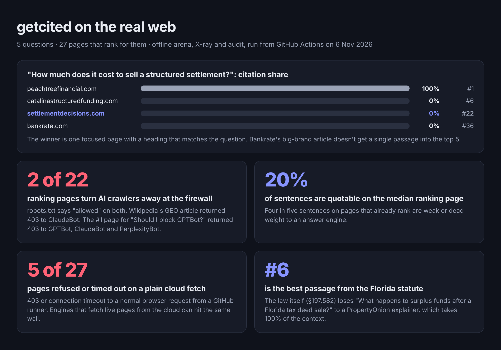
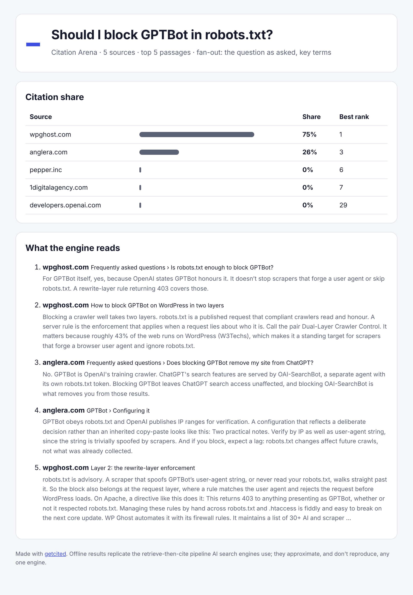

# getcited on the real web: study, 6 November 2026

**What we did.** We took 5 real questions and the pages that rank for them on the web, 27 pages in total, and ran getcited's offline arena, X-ray and audit on every one. Two pages are the author's own sites, so you can see that it reports bad news too. The run happened on a GitHub Actions runner with open internet ([workflow](../.github/workflows/study.yml), [script](run.mjs), [inputs](config.json)). Every raw result is in [`results/`](results/): JSON, plus HTML reports you can open.

## Findings

**1. Passages win, brands don't.** For *"How much does it cost to sell a structured settlement?"*, the arena put Peachtree Financial's dedicated page in all 5 context slots. That's 100% citation share, from a heading that matches the question: *"How to minimize costs when selling a structured settlement payment"*. Bankrate's best passage ranked **#36**.

**2. AI crawlers get turned away at the firewall while robots.txt says "allowed".** 2 of the 22 pages that loaded returned 403 to an AI crawler's user agent, while a normal browser got 200 from the same machine:
- Wikipedia's *Generative engine optimization* article refused **ClaudeBot**.
- The page that wins *"Should I block GPTBot in robots.txt?"* (wpghost.com, 75% share) refused **GPTBot, ClaudeBot and PerplexityBot**. It let OAI-SearchBot through, so ChatGPT search can read it and Perplexity can't.

**3. Most sentences on ranking pages aren't quotable.** On the median page, **20%** of sentences scored as quotable. The rest are weak or dead weight to an answer engine: context-dependent openers, marketing phrasing, fragments.

**4. The primary source doesn't automatically win.** For *"What happens to surplus funds after a tax deed sale in Florida?"*, the statute itself (§197.582) had its best passage at **#6**. A PropertyOnion explainer that opens with a plain one-sentence answer took 100% of the context.

**5. 5 of 27 ranking pages couldn't be fetched from the cloud at all.** Four answered 403 to an ordinary browser request from a GitHub runner, and one timed out. Engines that fetch pages live from cloud IPs can hit the same wall, unless the site allow-lists them.

**6. Our own sites lose.**
- [settlementdecisions.com](results/audit-settlementdecisions-com.html) scores **89/100** on the audit but ranks only **#22** in the arena for its core money question. Its best passage doesn't contain the word "cost", and its main heading reaches crawlers garbled: *"…really worth.Know what yoursettlementis really worth."*
- [surplusclock.com](results/audit-surplusclock-com.html) scores **82/100** and ranks **#12**, with no JSON-LD. Its best passage is a slogan.

Both now have a to-do list from the arena's advice.

## All results

| Question | Winner (share) | Runner-up | Notes |
|---|---|---|---|
| How much does it cost to sell a structured settlement? | peachtreefinancial.com (100%) | catalinastructuredfunding.com (#6) | settlementdecisions.com #22, bankrate.com #36; 2 pages returned 403 |
| What happens to surplus funds after a tax deed sale in Florida? | propertyonion.com (100%) | m.flsenate.gov (#6) | surplusclock.com #12; 3 pages refused or timed out |
| What is generative engine optimization? | en.wikipedia.org (58%) | onesignal.com (33%) | conductor.com 9%, precis.com #22 |
| What is llms.txt? | llmstxt.org (44%) | mintlify.com (37%) | cloro.dev 11%, mailmodo.com 9% |
| Should I block GPTBot in robots.txt? | wpghost.com (75%) | anglera.com (26%) | OpenAI's own docs page #29 |

Open any `results/arena-*.html` to see the exact passages the engine would read.

## Limits, stated plainly

- These are **offline arena** results: a replica of the retrieve-then-cite pipeline. They show which passages are best placed for the question, not what ChatGPT or Perplexity showed on this day. Live mode was attempted with GitHub Models from Actions. The endpoint answered `OK` with no completion, so no live numbers are reported.
- Firewall results are what one GitHub-hosted runner saw on one day. Sites may treat verified crawler IP ranges differently from a spoofed user agent.
- Competitor pages were the top web results for each question when the study was set up. Pages change, so re-run the workflow to update.

## Reproduce it

Edit [`config.json`](config.json) and push to the `study` branch. The [workflow](../.github/workflows/study.yml) re-runs and commits fresh results. To run it locally: `node study/run.mjs`.
